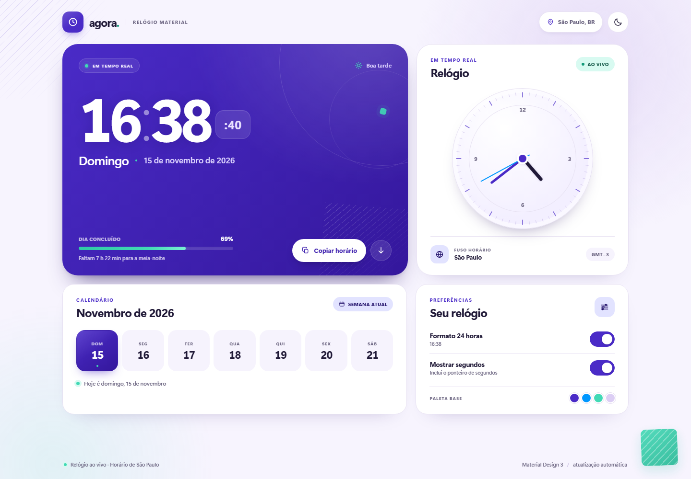
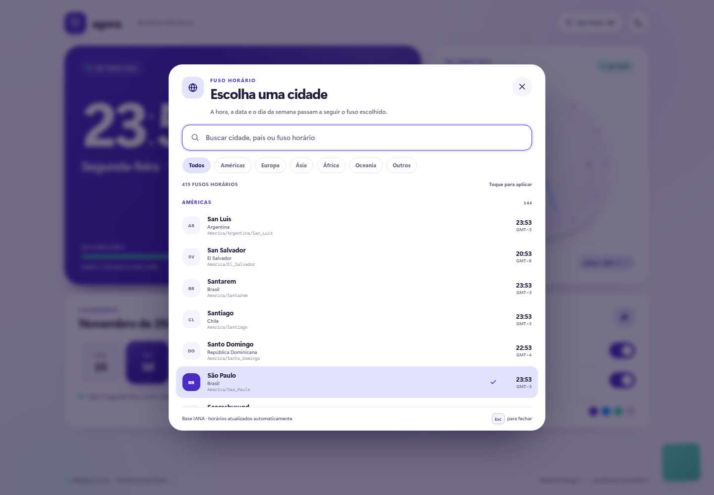

# Agora — relógio material

Site estático que mostra **hora, data e dia da semana** em tempo real, com visual inspirado no Material Design 3 e na paleta de referência anexada.





## Como abrir

Não há dependências nem etapa de build. Basta abrir o `index.html` no navegador.

Para uma experiência completa (especialmente do botão **Copiar horário**, que usa a área de transferência), recomenda-se servir a pasta localmente:

```bash
python -m http.server 8080
```

Depois acesse `http://localhost:8080`.

## Recursos

- Relógio digital com segundos e relógio analógico sincronizados.
- Dia da semana e data completa em português.
- Calendário da semana atual com destaque para hoje.
- Progresso do dia e tempo restante até a meia-noite.
- Seletor com **419 fusos horários IANA**, busca por cidade, país ou identificador e filtros por região.
- Ao escolher um fuso, hora, data, dia da semana, calendário, saudação e progresso do dia mudam juntos.
- Alternância entre formato 24 h e 12 h, com meia-noite como `00:00 AM` e meio-dia como `12:00 PM`.
- Opção para ocultar os segundos no relógio digital e analógico.
- Tema claro/escuro e fuso escolhido salvos no navegador.
- Botão para copiar o horário, com snackbar de confirmação.
- Layout responsivo, navegação por teclado e respeito a `prefers-reduced-motion`.

## Estrutura

| Arquivo | Função |
| --- | --- |
| `index.html` | Estrutura e conteúdo da página |
| `styles.css` | Sistema visual, layout, temas e seletor de fuso |
| `script.js` | Relógio, calendário, preferências e troca de fuso |
| `timezone-data.js` | Países e nomes de cidades por fuso (base IANA) |
| `favicon.svg` | Ícone do site |
| `preview-desktop.png` | Prévia em desktop |
| `preview-mobile.png` | Prévia completa em mobile |
| `preview-timezones.png` | Seletor de fuso em desktop |
| `preview-timezones-mobile.png` | Seletor de fuso em mobile |

## Paleta

As cores principais foram extraídas da imagem de referência:

| Cor | Hex |
| --- | --- |
| Roxo principal | `#4A2BC7` |
| Azul | `#0097FF` |
| Verde-água | `#41D9B5` |
| Lilás | `#DCCEF4` |
| Cinza de superfície | `#F2F2F2` |

Os tokens ficam no topo de `styles.css`, em `:root` e `[data-theme="dark"]`.

## Personalização do fuso

O fuso inicial é `America/Sao_Paulo` e a escolha do usuário fica salva em `localStorage` com a chave `agora-timezone`. Para trocar o padrão, altere a constante `DEFAULT_TIME_ZONE` no início de `script.js`.

A lista combina os fusos disponíveis em `Intl.supportedValuesOf("timeZone")` com metadados de países e cidades em `timezone-data.js`, gerados a partir do IANA tzdb (`zone1970.tab` e `backward`, domínio público). Por isso, a lista pode variar ligeiramente conforme o navegador, mas inclui todos os fusos que ele reconhece.

